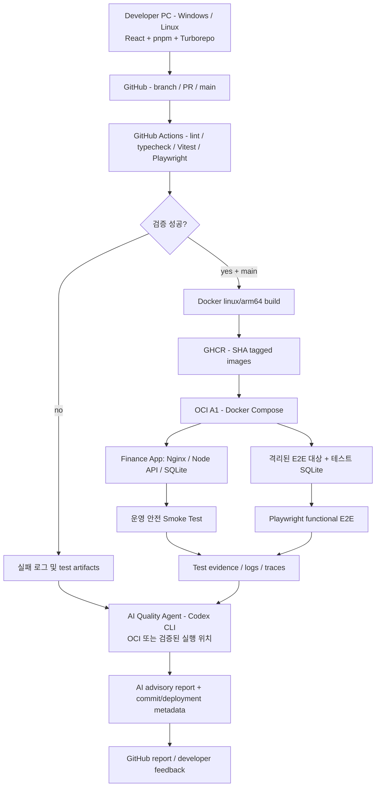

# ARCHITECTURE — DevFlowOps 목표 설계

> **설계 문서. 실제 구현과 일치하는지 작업 시작 시 반드시 확인할 것.**

## 1. 시스템 개요



**주의:** CI 실패 이벤트와 배포 성공 이벤트는 서로 다르다. OCI에 배포되지 못한 CI 실패의 로그를 OCI Agent로 보내려면 **별도 연동·인증·트리거**가 필요하다. 다이어그램의 연결만으로 구현된 것이 아니다.

## 2. 권장 폴더 구조

```text
devflowops/
├── README.md
├── AGENTS.md
├── docs/
│   ├── PROJECT_CONTEXT.md
│   ├── DECISIONS.md
│   ├── ARCHITECTURE.md
│   ├── AI_QUALITY_AGENT.md
│   ├── ROADMAP.md
│   └── DEVELOPMENT_GUIDE.md
├── apps/
│   ├── finance-web/          # React + TypeScript + Vite
│   └── finance-api/          # Node API, framework TBD
├── packages/
│   ├── ui/                   # 공용 표현 컴포넌트
│   ├── domain/               # 공유할 가치가 있는 순수 계약/계산
│   ├── utils/                # 순수 함수
│   ├── config-eslint/
│   └── config-ts/
├── tools/
│   └── quality-agent/        # collector / runner / analyzer / reporter
├── tests/
│   └── e2e/
├── infra/
│   ├── docker/
│   └── compose/
├── .github/
│   └── workflows/
│       ├── ci.yml
│       └── deploy.yml
├── pnpm-workspace.yaml
├── pnpm-lock.yaml
├── turbo.json
└── package.json
```

이 폴더 구조는 **목표 예시**다. 실제 사용하는 패키지만 생성한다. 특히 두 번째 데모 앱은 불필요하다.

## 3. 개발/빌드 플랫폼

- pnpm은 workspace 의존성과 lockfile을 관리한다.
- Turborepo는 앱·패키지의 작업 그래프, 캐시, 변경 영향 기반 실행을 담당한다.
- 기본 CI는 정확성이 우선이다. 변경 영향 기반 최적화를 하더라도 공통 패키지 변경이 소비 앱에 미치는 영향은 보존해야 한다.
- AI가 테스트 실행 범위의 유일한 판단자가 되지 않는다. 먼저 정적 의존성/명시적 규칙을 적용하고 AI는 누락 위험을 제안한다.
- 변경 전후 CI 소요 시간 비교는 동일한 조건/시나리오로 측정한다.

## 4. GitHub Actions 경계

### PR 검증(`ci.yml`)

- Checkout → Node/pnpm 설정 → frozen lockfile install.
- Lint, typecheck, Vitest, 필요 E2E, Build validation.
- PR 검사 결과 및 실패 로그·테스트 artifacts 생성.
- 신뢰하지 않는 PR 코드를 OCI의 Codex 구독 인증 정보가 있는 환경에서 실행하지 않는다.

### 릴리스 및 배포(`deploy.yml`)

- `main`의 검증된 커밋에만 배포 실행.
- Docker Buildx 등으로 `linux/arm64` 이미지를 빌드하고 GHCR에 commit SHA 태그로 보관.
- OCI에서 Compose pull/up, 서비스 health/version 확인.
- 배포 성공 이후 운영 Smoke Test 실행 및 후속 분석 트리거.
- 재배포/복구 절차, SQLite 영속 볼륨, 백업/복원을 별도 정의한다.

AI 호출 성공 여부는 기본 PR 검사·빌드 성공의 조건과 분리한다. AI 분석 실패는 별도 상태로 기록한다. 결정론적 테스트 실패는 실패 상태를 유지한다.

## 5. OCI 런타임의 분리

- 상시 실행: Nginx(React 정적 배포/프록시), Node API, SQLite(호스트 볼륨).
- 필요 시 실행: Playwright test runner / Quality Agent / Codex CLI.
- 운영 앱의 DB를 변경하는 E2E는 금지. 변경/삭제 테스트는 별도 데이터베이스 및 격리된 환경에서만 실행한다.
- Agent의 Docker socket, SSH 키, OCI 관리자 자격증명, 운영 데이터 접근은 기본적으로 제공하지 않는다.
- 테스트를 실행한 다음 브라우저를 종료하고 AI 분석을 수행하는 방식으로 제한된 CPU/메모리를 활용한다.
- 프로덕션 서비스는 Vite dev server가 아니라 빌드된 정적 번들을 제공한다.

## 6. 결과 추적 및 보고

모든 분석 결과에 가능한 범위 내에서 아래 메타데이터를 포함한다.

- Git commit SHA, 브랜치/PR(해당 시), GitHub Actions run ID.
- 배포된 이미지 태그 및 서비스 버전, 환경, 실행 시각.
- 테스트 종류/실행 수/성공/실패/건너뜀, 증거 파일 링크.
- Codex CLI 모델/버전(확인 가능한 경우), 분석 성공/실패, 근거 로그.
- AI의 원인 후보와 신뢰 근거, 사람이 수행할 확인 단계.

보고서는 JSON(기계 판독) + Markdown(사람이 읽기 쉬움) 형태를 우선 검토한다. GitHub에 게시하는 구현 방식은 미정.

## 7. 보안·운영 경계

GitHub 저장소의 공개 여부 자체는 OCI 인스턴스에 비밀 정보가 공개된다는 뜻이 아니다. 진짜 통제 대상은 SSH, 파일 권한, 토큰, Agent가 실행하는 코드, 의존성 공급망 및 네트워크 노출이다. 외부 PR/로그/웹 콘텐츠의 프롬프트 인젝션도 고려한다.

- 원격 Codex 인증 파일은 깃·이미지·CI artifact에 넣지 않는다.
- 구독 기반 자동 실행이 정상 동작하는지 검증한 후 사용한다. 실패 시 AI 단계를 건너뛰되 자동 테스트와 배포는 유지한다.
- Finance App에 실제 자산/거래 데이터를 넣는다면 외부 노출을 제한하고 백업을 준비한다.
