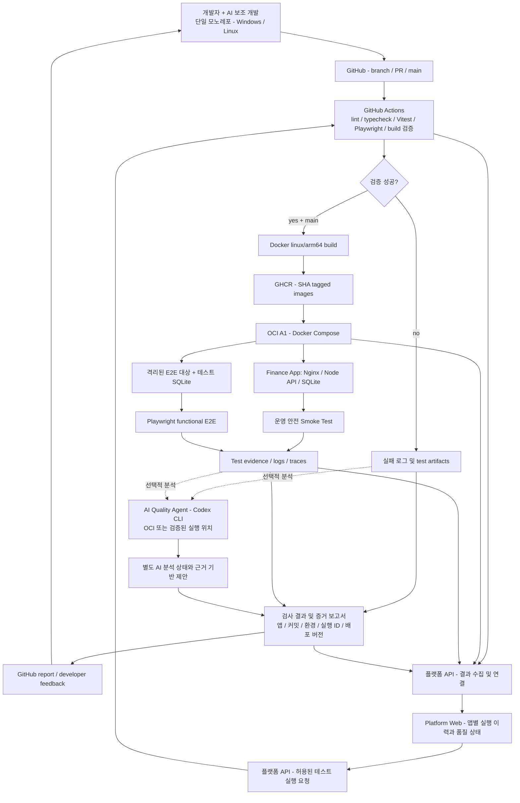

# ARCHITECTURE — DevFlowOps 목표 설계

> 목표 설계와 책임 경계를 관리하는 문서다. 현재 구현은 [개발 진행 현황](DEVELOPMENT_STATUS.md), 결정 상태는 [결정 기록](DECISIONS.md)을 따른다. 실제 파일과 일치하는지는 작업 시작 시 확인한다.

## 1. 시스템 개요

이 흐름은 [개발 목표 유지 기준](PROJECT_CONTEXT.md#개발-목표-유지-기준)을 실행 구조로 표현한 목표 설계다. 개발자와 AI의 작업부터 검사·배포·QA·피드백까지 연결하되 검사 실행과 AI 분석의 성공 여부는 분리한다.



**주의:** CI 실패 이벤트와 배포 성공 이벤트는 서로 다르다. OCI에 배포되지 못한 CI 실패의 로그를 OCI Agent로 보내려면 **별도 연동·인증·트리거**가 필요하다. 다이어그램의 연결만으로 구현된 것이 아니다.

PR 검증 실패는 배포로 진행하지 않고 결과·증거 보관과 개발자 수정으로 이어진다. 검증을 통과한 main 커밋만 이미지 빌드·GHCR 발행·배포로 연결한다. 배포 성공 후에는 실제 배포 버전을 대상으로 QA를 수행한다. AI 결과는 기본 보고서에 보조 정보로 연결하며, AI 응답을 기다리거나 AI 성공을 요구하지 않고 기본 결과를 생성·조회할 수 있어야 한다.

개발 포털은 앱·커밋·환경·실행 ID와 배포 버전을 기준으로 CI·배포·QA·선택적 AI 분석 및 원본 증거를 연결한다. 조회를 먼저 구현하고 제한된 테스트 실행 요청으로 확장한다. AI 분석 완료는 포털 조회의 선행 조건이 아니다. 상세 책임은 [플랫폼 관리 화면과 앱별 실행 구조](#8-플랫폼-관리-화면과-앱별-실행-구조)를 따른다.

## 2. 권장 폴더 구조

```text
devflowops/
├── README.md
├── AGENTS.md
├── docs/
│   ├── PROJECT_CONTEXT.md
│   ├── DECISIONS.md
│   ├── TECH_STACK.md
│   ├── ARCHITECTURE.md
│   ├── AI_QUALITY_AGENT.md
│   ├── ROADMAP.md
│   └── DEVELOPMENT_GUIDE.md
├── apps/
│   ├── platform-web/        # 관리 UI: 결과 조회 → 테스트 실행 요청
│   ├── platform-server/     # 포털 백엔드: GitHub 연동·결과 연결
│   ├── finance-web/         # React + TypeScript + Vite
│   └── finance-server/      # Finance 도메인·API·DB·마이그레이션
├── packages/
│   ├── ui/                   # 공용 표현 컴포넌트
│   ├── domain/               # 공유할 가치가 있는 순수 계약/계산
│   ├── utils/                # 순수 함수
│   ├── config-eslint/
│   └── config-ts/
├── tools/
│   └── quality-agent/        # 공통 수집·실행·보고 및 선택적 AI 분석
├── tests/
│   └── e2e/                 # 앱 간 통합 시나리오가 실제로 필요할 때
├── infra/
│   ├── docker/
│   └── compose/
├── .github/
│   └── workflows/
│       ├── ci.yml
│       └── deploy.yml
├── pnpm-workspace.yaml
├── pnpm-lock.yaml
├── turbo.json
└── package.json
```

이 트리는 목표 구조이며 실제 파일 목록이 아니다. 공용 패키지·실행 도구·인프라는 필요한 구현 단계에 추가한다. 특히 두 번째 데모 앱은 불필요하다. `platform-web`은 플랫폼 자체 기능이며 추가 데모 앱이 아니다. 앱별 테스트는 각 앱에서 관리하고 루트 `tests/e2e`는 필요한 앱 간 시나리오에만 사용한다. `packages/*`나 실행 가능한 `tools/*`를 워크스페이스 패키지로 도입할 때 pnpm workspace glob도 함께 추가한다.

백엔드는 앱별 `package.json`으로 의존성과 작업 명령을 관리하고 루트 pnpm/Turborepo가 전체 작업을 조율한다. 실제 실행·API·DB 설정과 서버 내부 파일별 책임은 [Finance 서버 안내](../apps/finance-server/README.md)를 따른다.

Finance의 HTTP API·비즈니스 로직·Drizzle 스키마·DB 연결·마이그레이션은 `finance-server`가 소유한다. 프론트엔드는 HTTP로 서버에 접근하고 ORM이나 DB를 직접 사용하지 않는다. `data/`는 로컬 개발용 위치이며 실제 DB 파일은 Git에서 제외한다. 플랫폼의 `results/`는 결과 수집·연결 코드를 둘 위치이며 DB나 원본 로그·Artifact를 저장하는 디렉터리가 아니다.

### Finance 내부 책임

API 계약은 요청·응답과 HTTP 제약을, Drizzle 스키마는 저장 구조와 DB 제약을 담당한다. 요청 검증과 OpenAPI 생성은 같은 API 계약을 사용하며 응답 런타임 검증 여부와 구분한다.

Finance 화면의 `src/features/transactions`는 API 요청, 조회·변경 상태, 입력 폼과 목록 UI를 소유한다. 대시보드는 조회 결과에서 화면용 합계를 계산한다. 서버는 HTTP 요청 처리와 데이터 저장을 소유한다. 개발 프록시와 DB 마이그레이션 절차는 [Finance 서버 안내](../apps/finance-server/README.md)를 따른다.

## 3. 개발/빌드 플랫폼

- pnpm은 workspace 의존성과 lockfile을 관리한다.
- Turborepo는 앱·패키지의 작업 그래프, 캐시, 변경 영향 기반 실행을 담당한다.
- 기본 CI는 정확성이 우선이다. 변경 영향 기반 최적화를 하더라도 공통 패키지 변경이 소비 앱에 미치는 영향은 보존해야 한다.
- AI가 테스트 실행 범위의 유일한 판단자가 되지 않는다. 먼저 정적 의존성/명시적 규칙을 적용하고 AI는 누락 위험을 제안한다.
- 변경 전후 CI 소요 시간 비교는 동일한 조건/시나리오로 측정한다.

## 4. GitHub Actions 경계

### PR 검증(`ci.yml`)

- Checkout → Node/pnpm 설정 → frozen lockfile install.
- Lint, typecheck, Vitest, 필요 E2E, Build validation.
- PR 검사 결과 및 실패 로그·테스트 artifacts 생성.
- 신뢰하지 않는 PR 코드를 OCI의 Codex 구독 인증 정보가 있는 환경에서 실행하지 않는다.

### 릴리스 및 배포(`deploy.yml`)

- `main`의 검증된 커밋에만 배포 실행.
- Docker Buildx 등으로 `linux/arm64` 이미지를 빌드하고 GHCR에 commit SHA 태그로 보관.
- OCI에서 Compose pull/up, 서비스 health/version 확인.
- 배포 성공 이후 운영 Smoke Test 실행 및 후속 분석 트리거.
- 재배포/복구 절차, SQLite 영속 볼륨, 백업/복원을 별도 정의한다.

AI 호출 성공 여부는 기본 PR 검사·빌드 성공의 조건과 분리한다. AI 분석 실패는 별도 상태로 기록한다. 결정론적 테스트 실패는 실패 상태를 유지한다.

## 5. OCI 런타임의 분리

- Finance와 포털을 각각의 Nginx 컨테이너로 별도 배포한다. 배포 구성의 결정 상태는 [결정 기록](DECISIONS.md)을 따른다.
- 상시 실행 목표: 앱별 Nginx(React 정적 배포/프록시), Node.js 백엔드. 서버 컨테이너의 통합·분리와 구체적인 서비스 구성은 미확정이다.
- SQLite는 Finance 서버가 `node:sqlite`로 접근하는 파일이며 별도의 DB 서버 컨테이너를 만들지 않는다. 운영 DB 디렉터리는 영속 볼륨에 두고 소스·이미지와 분리한다. 볼륨 종류·경로와 일관된 백업·복원 방식은 상세 설계 전이다.
- 컨테이너 간 필요한 API 통신은 Docker 네트워크에서 서비스 이름과 내부 포트를 사용하는 방향이다. 브라우저에서 실행되는 React 코드는 Docker 내부 서비스 이름으로 직접 접근하지 않는다. 네트워크 범위·포트·도메인·HTTPS·프록시와 접근 제어는 별도 설계한다.
- Finance와 플랫폼 서버 간 직접 통신은 실제 필요한 기능에 한해 추가한다. 네트워크 연결만을 위해 두 서버가 서로 의존하도록 만들지 않는다.
- 필요 시 실행: Playwright test runner / Quality Agent / Codex CLI.
- 운영 앱의 DB를 변경하는 E2E는 금지. 변경/삭제 테스트는 별도 데이터베이스 및 격리된 환경에서만 실행한다.
- Agent의 Docker socket, SSH 키, OCI 관리자 자격증명, 운영 데이터 접근은 기본적으로 제공하지 않는다.
- 테스트를 실행한 다음 브라우저를 종료하고 AI 분석을 수행하는 방식으로 제한된 CPU/메모리를 활용한다.
- 프로덕션 서비스는 Vite dev server가 아니라 빌드된 정적 번들을 제공한다.
- 앱별 배포 후 QA는 대상 주소와 배포 커밋·버전을 연결한다. 웹 컨테이너 분리가 단위·API 테스트의 책임을 바꾸지는 않으며, 공용 코드 변경 시 영향받는 앱을 함께 검증한다.

## 6. 결과 추적 및 보고

모든 분석 결과에 가능한 범위 내에서 아래 메타데이터를 포함한다.

- Git commit SHA, 브랜치/PR(해당 시), GitHub Actions run ID.
- 배포된 이미지 태그 및 서비스 버전, 환경, 실행 시각.
- 테스트 종류/실행 수/성공/실패/건너뜀, 증거 파일 링크.
- Codex CLI 모델/버전(확인 가능한 경우), 분석 성공/실패, 근거 로그.
- AI의 원인 후보와 신뢰 근거, 사람이 수행할 확인 단계.

보고서는 JSON(기계 판독) + Markdown(사람이 읽기 쉬움) 형태를 우선 검토한다. GitHub에 게시하는 구현 방식은 미정.

## 7. 보안·운영 경계

GitHub 저장소의 공개 여부 자체는 OCI 인스턴스에 비밀 정보가 공개된다는 뜻이 아니다. 진짜 통제 대상은 SSH, 파일 권한, 토큰, Agent가 실행하는 코드, 의존성 공급망 및 네트워크 노출이다. 외부 PR/로그/웹 콘텐츠의 프롬프트 인젝션도 고려한다.

- 원격 Codex 인증 파일은 깃·이미지·CI artifact에 넣지 않는다.
- 구독 기반 자동 실행이 정상 동작하는지 검증한 후 사용한다. 실패 시 AI 단계를 건너뛰되 자동 테스트와 배포는 유지한다.
- Finance App에 실제 자산/거래 데이터를 넣는다면 외부 노출을 제한하고 백업을 준비한다.

## 8. 플랫폼 관리 화면과 앱별 실행 구조

아래 연동 구조는 목표 설계다. 같은 모노레포에서 플랫폼 UI·실행 도구·대상 앱을 관리한다. GitHub는 코드·리뷰와 CI/CD 실행 기반을, 관리 화면은 앱별 실행 및 품질 추적을 담당한다.

### 책임과 데이터 흐름

| 구성 요소 | 책임 |
|---|---|
| `apps/platform-web` | 앱 현황, 실행 이력·상세, CI/CD·배포 후 QA 결과, 허용된 테스트 실행 요청 |
| 플랫폼 서버 (`apps/platform-server`) | 앱 설정 검증, 실행 요청 접수, 실행 상태·결과 조회, GitHub 연동 |
| GitHub Actions / QA 실행기 | 허용된 작업 실행, 결정론적 결과와 증거 생성 |
| 공통 QA 도구 (`tools/quality-agent` 경로 제안) | CLI/CI/관리 화면에서 재사용하는 검사 실행·증거 수집·보고, 선택적 AI 분석 연결 |
| AI 분석 모듈 | 수집한 증거를 바탕으로 실패 원인 후보·테스트 누락·추가 확인을 제안. 검사 판정과 배포 승인을 소유하지 않음 |
| 대상 앱 (`apps/finance-web` 등) | 기능 코드, 테스트 시나리오, 앱별 실행 설정 |

1. 결과 조회: Actions 및 QA 실행 결과 → 플랫폼 API의 수집·연결 → 관리 화면. 원본 로그·Artifact는 링크로 제공한다.
2. 테스트 실행: 관리 화면 → 플랫폼 API에서 요청 검증 → 허용된 Actions 워크플로/격리 실행기 → 결과 수집 → 화면 상태 갱신.
3. 브라우저는 셸 명령을 직접 실행하지 않는다. UI·API·CLI는 같은 실행/결과 계약을 사용하고 테스트 실행 로직을 각각 복제하지 않는다.

### 앱 추가와 모듈 경계

- 관리 앱 목록은 현재 워크스페이스 범위인 `apps/*/package.json`의 이름으로 발견한다. 발견한 앱은 목록에 표시할 수 있지만 이것이 테스트 실행 허용이나 배포 등록을 뜻하지는 않는다. 개발 중에는 파일 변경을 반영하고 배포 화면은 빌드 시점 목록을 사용한다. 구체적인 표시 규칙은 [앱 자동 발견 절차](DEVELOPMENT_GUIDE.md#9-포털-관리-앱-자동-발견)를 따른다.
- 앱 ID, workspace, 지원 검사 종류, 검증 명령 또는 workflow 식별자, 허용 환경, 배포/health check 대상과 결과 위치를 등록하는 설정을 설계한다. 정확한 파일명·스키마는 구현 시 확정한다.
- 공통 파이프라인은 실행·수집·보고를 담당하고, 앱은 도메인별 테스트를 제공한다. 공통 UI나 결과 계약은 실제 공유가 발생할 때 `packages/`로 추출한다.
- pnpm/Turbo 그래프와 정적 규칙으로 영향 앱을 결정한다. 같은 저장소에서도 앱별 검사·배포가 가능하도록 설계한다.
- 외부 저장소 지원은 후속 확장이다. 현재 목표를 위해 앱을 분리하거나 데모 앱을 늘리지 않는다.

### 결과와 실행 상태

- 앱 ID, 커밋 SHA, 브랜치, 환경, 실행 종류, 실행 ID/재시도 회차, Actions run ID, 시작·종료 시각과 원본 증거 링크를 연결한다.
- 배포된 이미지 SHA 및 QA 대상 버전을 별도로 기록한다. 같은 브랜치의 최신 CI 결과를 다른 배포 버전의 QA 결과와 섞지 않는다.
- 요청/대기/실행 중/완료 상태와 성공/실패/취소/미실행 결과를 구분한다. 결과 수집 실패·정보 없음·오래된 결과를 성공으로 표시하지 않는다.
- AI 분석 상태는 테스트·CI/CD 결과와 독립적으로 표시한다. AI가 실패해도 결정론적 결과와 증거는 조회할 수 있어야 한다.

### 단계와 운영 경계

- 먼저 Finance App의 결과 조회를 완성하고, 이후 제한된 수동 테스트 실행을 지원한다. 관리 UI 장애가 기본 CI/CD나 CLI 실행을 막지 않도록 한다.
- 실행 API는 등록된 앱·작업·환경만 허용한다. 임의 명령·경로·URL 입력을 실행하지 않고, GitHub 인증 정보는 서버에서만 보관한다.
- 실행 기능 도입 전 접근 제어, 실행 가능한 커밋의 신뢰 범위, 중복 요청·동시 실행 제한, 시간 제한과 이력 기록을 설계한다. 인증 방식은 아직 선택하지 않았다.
- 운영은 읽기 전용 Smoke Test만 실행한다. 데이터 변경 테스트는 격리된 앱/DB를 사용한다. 운영 배포·롤백 실행 버튼은 초기 범위에서 제외한다.
- 결과 저장·보존, GitHub 이벤트 수신/폴링, 재수집 방식, API 배포 단위 및 OCI 자원 적합성은 상세 설계와 검증이 필요하다. Finance DB와 플랫폼 실행 메타데이터의 책임을 분리하며 실사용 금융 데이터를 결과 저장에 사용하지 않는다.
